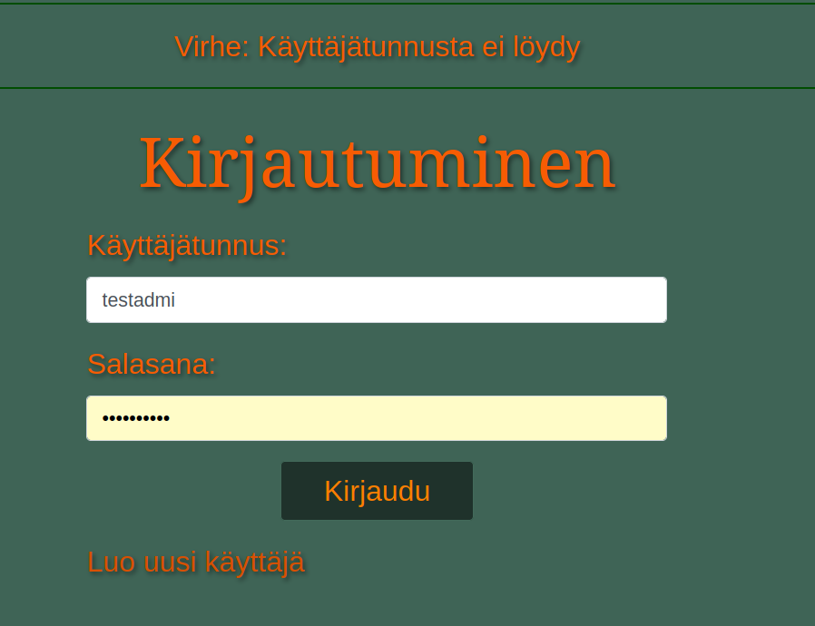
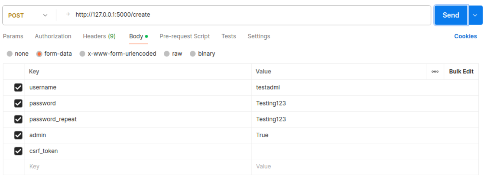
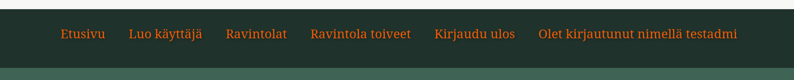
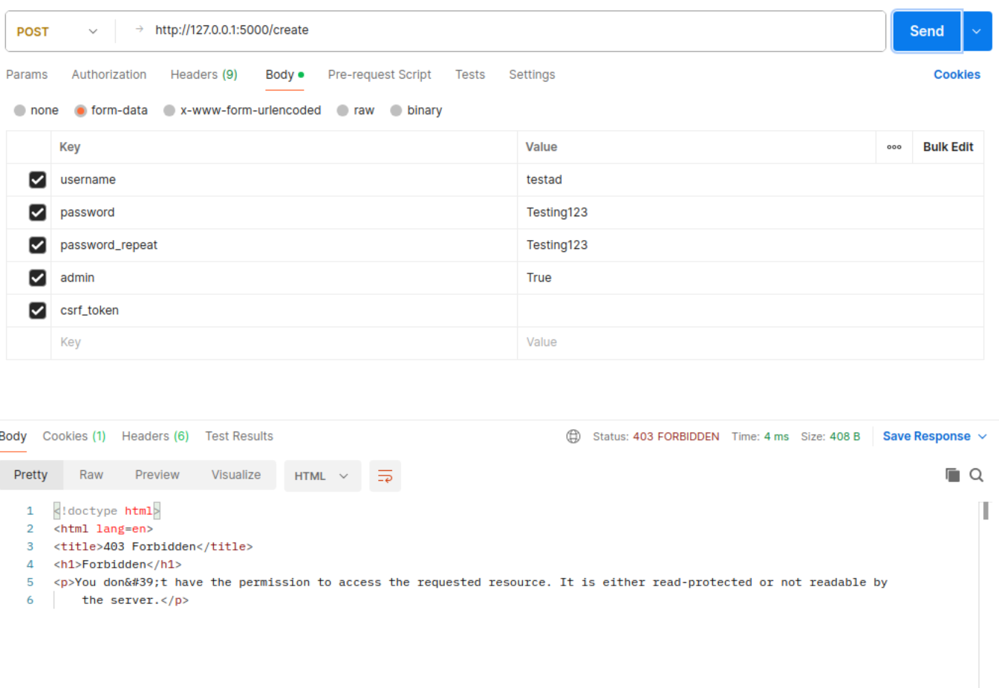
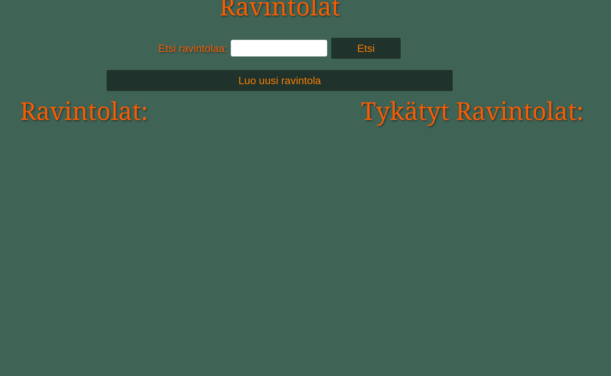
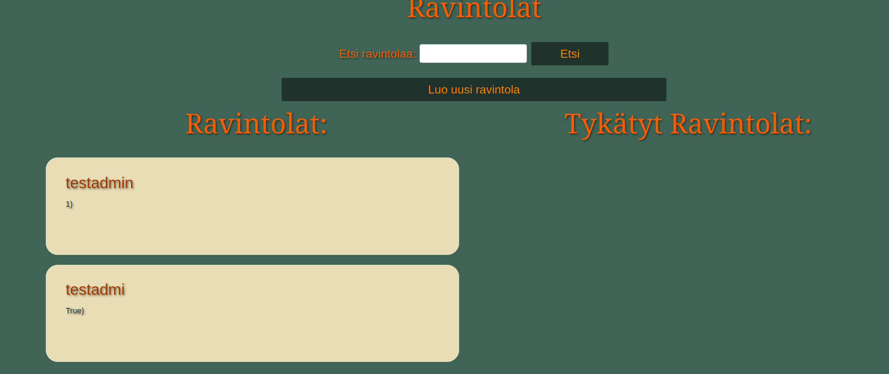
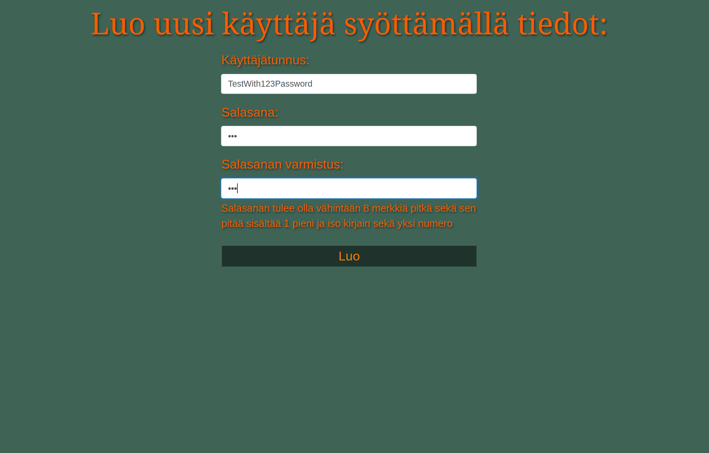
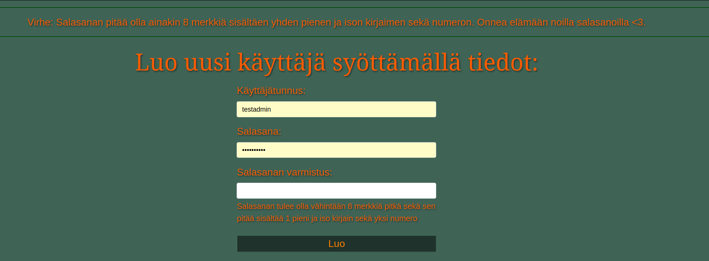
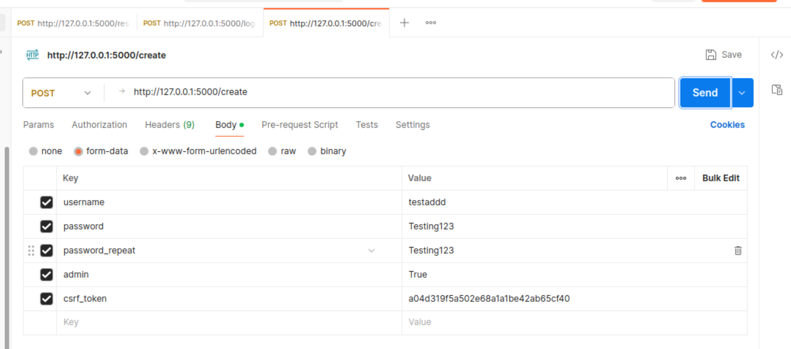

### This is a practice project for a course.

# RestaSearch (UPDATED FOR CSB)
This application is meant to allow users to create,review and search restauraunts with some minor additional features.


## Basic info and functionalities explained
There are 2 types of users: Basic and Admin.
Basic users can create restaurant requests. Requests can be viewed on a separate page and can be accepted as official by an admin.
Basic users can review restaurants and them as favourites. Favourite restaurants are shown in a separate list.
Basic users can also delete their own reviews.

Admin users have all of the above and extra: 
Admin created restaurants are automatically added to the official list and they can approve user created restaurants. 
Admins can create other admin accounts.
Admins can remove restaurants or reviews from any user account.

## Getting Started

### Prerequisites
1. **Python 3** - Make sure Python 3 is installed on your system.
2. **Sqlite3** - also install sqlite3
3. **Postman/devtools** or other method of bypassing frontend. 

### Steps

1. **Clone this repository**  
   Download or clone this repository to your computer.

2. **Create an `.env` file**  
   Inside the `pythonFlaskBackend` folder, create a file named `.env` and add the following:
   ```env
   dburl="Insert your sqlite address here, e.g. dburl="sqlite:///restasearch.db""
   SECRET="Insert a proper hex token here"
   ```

3. **Set up the Python environment**
   - Open a command-line interface in the `pythonFlaskBackend` folder and run:

     **Linux / Mac:**
     ```bash
     python3 -m venv venv
     source venv/bin/activate
     pip install -r requirements.txt
     ```

     **Windows (cmd):**
     ```bat
     python -m venv venv
     venv\Scripts\activate
     pip install -r requirements.txt
     ```

4. **Initialize the Database**
   - Run the following command to create the necessary tables and initial schema:
     ```bash
     flask init-db
     ```

5. **Start the Application**
   - Start the Flask server with:
     ```bash
     flask run
     ```

### Login Information
- **Admin Account**  
  You can log in using:
  - **Username**: `testadmin`
  - **Password**: `Testing123`

- **Create a admin account**

  To do this you need to first login with the credentials provided above.

- **Create a User Account**  
  Alternatively, you can create a new user account with default privileges.


----
# Cybersecurity testing section (Chosen OWASP list of year 2021)

## Flaw 1:
Exact link to flaws: [delete restaurant](https://github.com/KirillosTY/RestaSearch/blob/main/pythonFlaskBackend/routes.py#L225-L230) and [creating admin account](https://github.com/KirillosTY/RestaSearch/blob/main/pythonFlaskBackend/routes.py#L77-L79)

Flaw: [Broken access control](https://top10.owasp.org/2021/A01_2021-Broken_Access_Control/): creating an admin account while not being an admin is currently only blocked from the frontend side by hiding the admin button, but nothing on the server side checks it. Thus, _while being logged out or non-admin_,  sending a simple post requests to server side still creates the admin account. Same basic principle works for deleting restaurants except you need to be logged in, then sending a post request will delete it.

Fix: Implement server side check if someone is admin or not to block frontend bypass.

### First try to show account does not exist (in e.g http://127.0.0.1:5000/create ):


### use browser dev the following way:


1. Do this logged out: got localhost + /create  e.g: http://127.0.0.1:5000/create
2. F12, go to Elements tab.
3. find the input <form ... action="/create">, right click to edit.
4. add this line.
`<input name="admin" value="true">` 
5. click anywhere outside the box, fill the rest correctly and submit.

### Or send a postman request to backend directly.
### 
### After sending you can log into the account and it has admin privileges.


### after fix you are blocked from creating admin accounts. 

### Same basic principle for restaurant deletion.


## Flaw 2:

Exact link to flaw and fix: [Sha-1 password crypting](https://github.com/KirillosTY/RestaSearch/blob/main/pythonFlaskBackend/users.py#L40-L43)
 
[Cryptographic Failures](https://top10.owasp.org/2021/A02_2021-Cryptographic_Failures/): using outdated sha-1 and hashing with one iteration round, the output is a 40 char hashed password. Sha-1 has been proven to be unsafe due to the fact that that the algorithm is designed to be fast. This would allow someone who has stolen database credentials to brute force the right passwords out.

Fix: use modern day hashing algorithms like scrypt that implement slow hash algorithms designed to slow down brute force guessing.


### How to check:

Create accounts, first without commented out code, then with commented out code and compare

Query with: 
```
sqlite3 instance/restasearch.db "SELECT username, password FROM users;"
```
### Results:
```
testadmin|scrypt:32768:8:1$PZ2c0REzdZzD4qNq$077f251eb890030ae2b2e838489020f8d4c1fcaca1dfefeb9680895b84513a4bdae268b367f472e672b1bca28564dc360946bd03a84ee8924d8eab90baa15584

testadmi|pbkdf2:sha1:1$0PMXe1bYIZsRYJN9$66eafa98aa2bbbee079f6bf174b55dbdefcbcb69
```

## Flaw 3:
Exact link to flaw: [fixed query](https://github.com/KirillosTY/RestaSearch/blob/ceb3b74d52a664bc30deb9cb5e00d5629d8788c0/pythonFlaskBackend/restaurant_db.py#L283).


[ SQL Injection](https://top10.owasp.org/2021/A03_2021-Injection/): Quering text directly sent from a user on the frontend without any kind of processing allows for SQL Injection. This means that the user can try to insert their own SQL commands via search bars etc e.g: 
```
        ...
        WHERE name 
        LIKE '%' || """+ search_text+ """|| '%'
        ... 
```
If search_text is now :
```  
        'UNION SELECT id, username, password, is_admin,NULL, NULL FROM users--'
```
it would allow the hacker to steal every credential from the database.

Fix: pass the frontend search_text with the ":"-prefix e.g. ":search_text". This binds the search_text for SQLalchemy to use the values as parametrized queries with bind parameters that make them safe by doing the following in SQLAlchemy:  
``` 
    t = text("SELECT * FROM users WHERE id=:user_id")
    result = connection.execute(t, {"user_id": 12}).
  
```
  SQLAlchemy builds the query without the user input, locks it and then treats the input data as just values to match against. 

### normal query



### injected returns the users...



    
    
# Flaw 4:
Exact link to flaw: [password requirements](https://github.com/KirillosTY/RestaSearch/blob/main/pythonFlaskBackend/routes.py#L109-L117). 

[Identification and Authentication Failures](https://top10.owasp.org/2021/A07_2021-Identification_and_Authentication_Failures/): Allow users to create any type of password of any length, making some basically useless. 

fix: Just add requirements and password checking e.g length at least 8, and require some special characters or capital letters at least with numbers.   
e.g. 
```
if not password_check(password):
    return render_template(
       "login.html",
        message="""Salasana tai käyttäjätunnus on väärin...Tsemppiä <3.""")
```
### Allows users to have password 123 and will pass



### with fix:


## Flaw 5:

Exact links to flaw (! You need to uncomment all of them!): [Enabling logging](https://github.com/KirillosTY/RestaSearch/blob/main/pythonFlaskBackend/app.py#L8-L13)and [User trying to enter with wrong password](https://github.com/KirillosTY/RestaSearch/blob/main/pythonFlaskBackend/routes.py#L58-L59) and [normal user trying to create admin account](https://github.com/KirillosTY/RestaSearch/blob/main/pythonFlaskBackend/routes.py#L82-L87) or [trying to delete restaurant](https://github.com/KirillosTY/RestaSearch/blob/main/pythonFlaskBackend/routes.py#L215-L217)


[Security Logging and Monitoring Failures ](https://top10.owasp.org/2021/A09_2021-Security_Logging_and_Monitoring_Failures/): No logging of any kind kind makes it harder to track where an attack is coming from, how it might be implemented or even protected against. In modern times, depending also on the product itself, there are legal requirements that demand it.


### fix:
Flask has a logger with built in functionalities. Monitoring should be done critical sections; users without admin access trying to admin actions. CSRF failures, or other type of login/credential failures. In this project these will be stored in security.log


### Devtools:

1. Do this logged out: got localhost + /create  e.g: http://127.0.0.1:5000/create
2. F12, go to Elements tab.
3. find the input <form ... action="/create">, right click to edit.
4. add this line.
`<input name="admin" value="true">` 
5. click anywhere outside the box, fill the rest correctly and submit.

### Postman: login first and get CSRF. Then trying to create an admin user as a normal user will result in the following logs

```
2026-11-14 15:23:40,282 WARNING user testadmin trying to login with wrong password, IP:127.0.0.1 login
2026-11-14 15:35:17,354 CRITICAL Logged in user testuser trying to an admin action while not admin create

```
